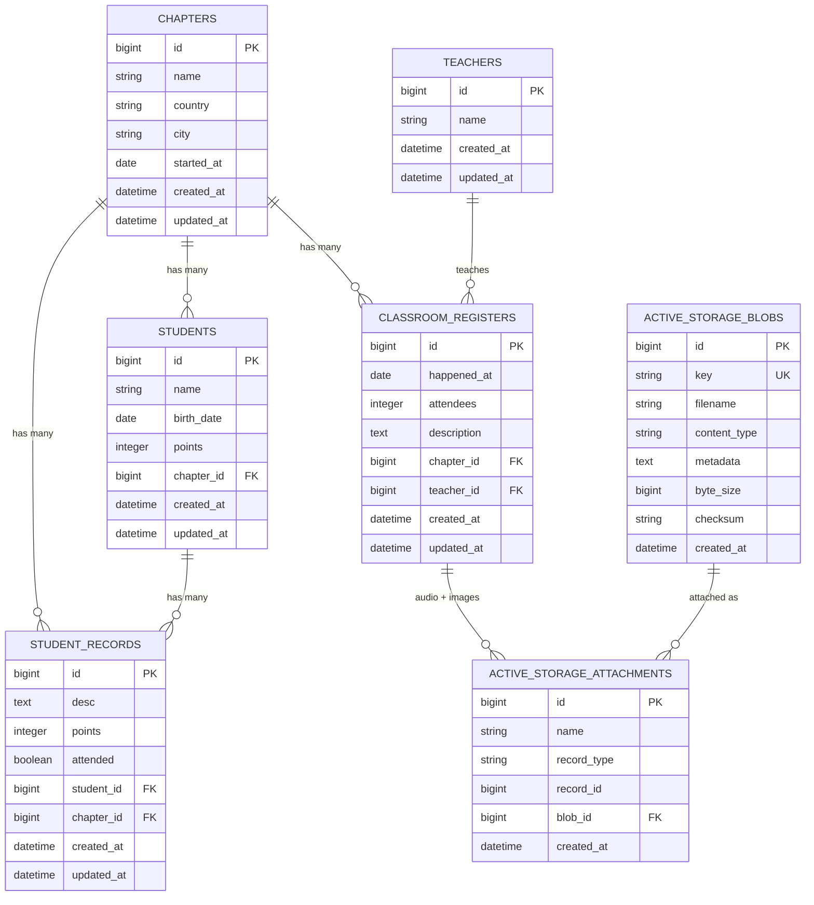

# ClassRegister — Database Schema

Entity-relationship diagram of the database as defined by `db/schema.rb`
(schema version `2026_08_26_014952`), running on **PostgreSQL 18**.

See [application-overview.md](application-overview.md) for what the application does.

---

## Diagram



---

## Reading the diagram

**`CHAPTERS` is the hub.** A chapter is a place where classes are taught (name, country, city,
and the date the chapter started). Students, classroom registers and student records all hang
off it.

**`CLASSROOM_REGISTERS` is one class session** — the date it happened, a headcount, a
description, and which chapter and teacher it belonged to. It is the only model with file
attachments: `has_one_attached :audio` and `has_many_attached :images`.

**`STUDENT_RECORDS` is a per-student note** — attended yes/no, points awarded, and a text
comment.

**The Active Storage link is polymorphic.** `active_storage_attachments.record_type` /
`record_id` can point at any model; in this application only `ClassroomRegister` attaches files.
The `name` column is what separates the two attachment types — rows with `name = 'audio'` are the
single recording, rows with `name = 'images'` are the photos. The relationship drawn above is
therefore a convention enforced by the application, not a foreign key enforced by the database.

---

## Notes on the schema

**`student_records` has no link to a session.** It references a student and a chapter, but not a
`classroom_register`. There is no way to ask "which class session was this record taken in?"
from the schema alone.

**`points` is stored in two places.** It is a column on `students` and also on
`student_records`, with nothing in the code keeping a student's total in step with the sum of
their records.

**Foreign keys are now real constraints.** All the `t.references` calls in `db/migrate/` pass
`foreign_key: true`. Under SQLite these never round-tripped into `db/schema.rb`, so the constraints
were effectively invisible and unenforced. On PostgreSQL all seven exist and are enforced by the
database:

```
students                       (chapter_id) -> chapters(id)
classroom_registers            (chapter_id) -> chapters(id)
classroom_registers            (teacher_id) -> teachers(id)
student_records                (student_id) -> students(id)
student_records                (chapter_id) -> chapters(id)
active_storage_attachments     (blob_id)    -> active_storage_blobs(id)
active_storage_variant_records (blob_id)    -> active_storage_blobs(id)
```

Note this means orphaned rows are now rejected at the database level. If any existing data has a
dangling `chapter_id` or `student_id`, it will fail to import.

**No column has a `NOT NULL` constraint or a default**, apart from the Active Storage tables and
the `created_at` / `updated_at` timestamps. Combined with the total absence of model validations,
every business field in the application is nullable.

**The Active Storage tables are now the Rails 8.1 layout.** `service_name` was added to
`active_storage_blobs`, the `active_storage_variant_records` table was created, and the `NOT NULL`
on `checksum` was relaxed — by the three migrations added during the upgrade.
